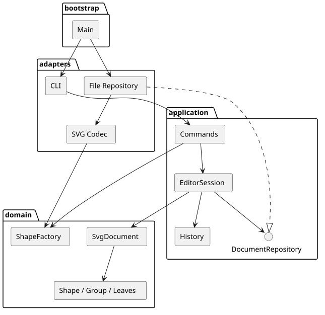
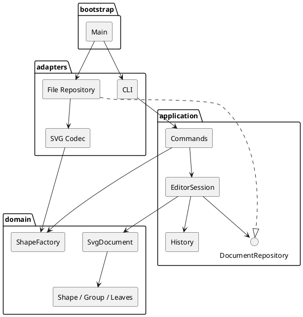

# 高级软件开发技术 · Lab1 个人作业

Git 仓库地址：**<https://github.com/POWERRRRRRRR/advanced-software-development-lab1-svg-editor>**（私有）。版本 `0.1.0`，课程交付标签 **`final`**。

本项目为 TypeScript 面向对象 SVG CLI 编辑器。原始附件 `phase_cli_1.md` 保留不变；实现全部 19 条命令与六种图形，并按用户确认增加常见 SVG 变换与文字样式兼容。GUI、box 和动态插件加载属于后续阶段。

## 运行与验收入口

要求 Node.js 22.13+，推荐 24。在仓库根目录执行：

```sh
npm ci
npm run cli
npm run check
npm run cli < examples/flowchart.commands
npm run build
npm start
```

回放示例生成 flowchart.svg，可直接用浏览器打开。交互输入 help 查看全部语法，Ctrl-D 或 Ctrl-C 退出。脚本包含错误时仍继续处理，最终以退出码 1 表示失败。

## 架构方案

### 模块划分与职责

| 模块            | 职责                                                    | 依赖规则与理由                                      |
| --------------- | ------------------------------------------------------- | --------------------------------------------------- |
| src/domain      | Shape 类层次、六种图形、文档树、唯一 id、几何与属性行为 | 仅依赖本层；业务不绑定终端、文件系统或 XML 库       |
| src/application | Command、会话、历史、持久化/展示端口                    | 依赖 domain 和本层；组织用例，不执行具体 IO         |
| src/adapters    | CLI 解析展示、XML codec、文件系统                       | 依赖 application、domain 与 Node/第三方库，实现端口 |
| src/bootstrap   | Main 装配、启动、版本                                   | 可以依赖所有层，集中建立对象关系                    |

测试和实验脚本可访问各层。接口/只读 DTO 用于边界传输，图形本身是封装数据和行为的类，不是公共数据袋。

### PlantUML 组件图



图源如下；在单独上传本文件时仍可直接查阅，渲染 SVG 与图源也保存在仓库 final 版本。



### 设计模式及落地

**Command（必需）**：每条命令独立类，CommandFactory 仅负责命令名到实现的注册。编辑命令继承 EditCommand，execute 进入会话事务，undo/redo 恢复完整快照。文档与显示命令使用独立实现，避免被错误加入编辑历史。

**Composite**：抽象 Shape 定义 move、scale、set、clone、只读描述等操作。Rect/Circle/Ellipse/Line/Text 封装自己的几何与内容，Group 组合子节点并递归处理。调用者操作容器或叶子时都调用同一接口；删除和分组处理整棵子树。

**Memento**：EditorSession 在当前文档副本上执行编辑，完成校验才提交，并将前后状态归该命令所有。历史恢复通过多态 clone 保留类行为，避免 JSON 还原造成数据袋。返回给查询方的文档也是副本，防止外部改变当前状态或 redo 快照。

**Factory 与依赖倒置**：六种类型共用 ShapeFactory，CLI 创建与 SVG 导入都使用它。DocumentRepository/DocumentPresenter 在应用层定义，适配器实现；领域不依赖 Node 或 XML 库。

按附件要求，仅两处允许名称分派：CommandFactory 的命令注册表、ShapeFactory 的类型注册表。它们登记为 TECH-01 待后续插件化重构；首版其他图形操作、展示与输出不再 switch(tag)。

### 数据流与关键约束

输入 → Tokenizer → CommandFactory → 命令 → 会话草稿 → 领域操作/校验 → 成功提交并入历史 → 输出。

读入 → XML 字符/实体与语法校验 → 全量显式 id 扫描 → 继承/变换规范化 → 共用图形工厂 → 完整文档校验 → 替换当前文档；警告仅在成功后输出。

始终维护唯一且大小写敏感的 id、无环和无共享节点、父子链接一致、索引与树一致、有限几何值及非负尺寸。失败不得改变文档、绑定路径、undo/redo。成功 init/read/save 或 canvas 修改清空旧历史并锁定撤销，下一次成功编辑开启新历史。

跨容器 group 使用最近公共父级，按原绘制顺序收编，并占最早选中分支位置；拒绝重复选择和祖先后代混选。front 最后绘制，back 最先绘制。根级容器不可解组，严格遵循附件。

### 变化点与取舍

| 未来变化          | 首版保留的空间或明确取舍                                     |
| ----------------- | ------------------------------------------------------------ |
| GUI/agent 等入口  | 命令与终端隔离，可增加适配器复用应用层                       |
| 新图形与 box 插件 | 集中注册工厂；首版不实现动态插件，避免越过阶段边界           |
| 其他存储和格式    | Repository 与独立 codec 隔离具体文件 IO                      |
| 大文档与长历史    | 快照确保结构恢复可靠；实测内存开销公开，后续可替换为增量历史 |
| 更多 SVG 特性     | 兼容范围明确，不能处理时失败且保护原文档；不静默删减         |

## 过程记录

1. **需求澄清**：AI 先读取附件、检查仓库与环境。用户要求按正规软件项目保留需求、决策、实验、缺陷与发布记录，并确认增加常见 SVG 兼容。随后建立 REQ-01～REQ-14 验收矩阵。
2. **工具链验证**：最新 TypeScript 7 与 typescript-eslint 的 peer 范围不兼容；通过 npm 实际安装发现，改用兼容的 TypeScript 6.0.3 并锁定依赖，没有强行忽略冲突。
3. **领域与命令迭代**：先实现多态图形和结构不变量，再实现事务命令。测试发现 Promise.resolve 参数求值会同步抛错，违反 execute 的异步契约；改成 async 并保留失败和历史恢复测试（BUG-001）。
4. **SVG 技术实验**：实际验证 XML 节点顺序、CDATA、中文和空白。采用紧凑输出，避免格式化插入额外文字空白；对未来显式 id 先预扫描，再补缺失 id。显式字号 inherit 先从解析后的样式重建，避免直接解析为数值。
5. **规范对齐**：导入 transform 要同时缩放线宽和字号以保留外观，CLI scale 则按附件仅缩放几何。通过原图和规范化图同环境渲染，确认 PNG 字节完全一致。
6. **验收发现与修复**：边界探针发现 XML 库的语法校验未拒绝未知实体，数字实体需显式启用解码；增加 XML 字符/实体验证并验证 CDATA 不被错误解码（BUG-002）。还修复外部 ellipse 单半径的默认值（BUG-003）。
7. **环境与流程调整**：GitHub 连接器对新私有仓库返回 404，使用已授权 gh；托管 CI 因账户账单/额度没有启动，明确登记 RISK-001/ADR-005，并实际在干净克隆下运行 Node 22/24 全套验证。用户后续要求先本地分步提交、最后统一推送，后半段据此执行。

代码、测试和自查由 Codex 实施。用户参与的是需求与流程选择；没有虚构用户逐行评审，也没有声称经过第二名工程师审批。详细记录、实际提交和 PR 见仓库工程日志。

## 一致性自查

**模块划分**：实际采用 domain/application/adapters/bootstrap，与方案一致。每个生产类位于同名文件；端口和只读传输类型单独文件。测试与实验脚本独立于生产代码。

**依赖方向**：TypeScript AST 架构测试逐个检查生产导入，domain 无 IO/第三方依赖，application 只依赖自身与 domain；adapters 实现应用端口，Main 负责装配。人工源码自查确认图形类型和命令名称查找只有两个工厂，其他 Map 查询是属性/id 查询，不是图形类型分派。

**修订记录**：增加边界 DTO 和应用端口属于原分层的具体落地；PlantUML 初始单行声明在真实渲染后改为多行。发布门槛因外部 CI 阻塞按 ADR-005 修订为本地交叉版本验证并披露远端未验证，未将阻塞隐藏为绿灯。

## 质量保证手段

- **63 项自动测试**：覆盖五类领域叶子及容器、所有编辑命令的完整撤销/重做、IO 历史屏障、非法参数与循环、失败后文档/路径/历史不变、转义/实体/样式/变换与 XML 往返。
- **真实入口验收**：直接从原附件提取第 6 节 19 条及流程图版本 A 14 条命令，通过子进程运行。前者出现预期两条错误并继续；后者正确保存 8 元素，移动已撤销且标签更新。
- **文件故障注入**：实际部分写入/重命名失败后原文件保持不变，临时文件清理；覆盖只读目标、缺失目录、符号链接和失败后 redo。
- **干净检出**：候选提交 `1941abbbafe55964d2a9568bec9f6876fedf849a` 从本地 Git 克隆，npm ci 安装后在 Node.js 22.23.4、24.22.1 均通过类型/规范/格式/63 项测试/构建，编译入口冒烟通过。原始日志随仓库提交。
- **交互与视觉验收**：真实 PTY 检查中文、提示符、撤销重做和 EOF；独立 Chrome profile 渲染并查看流程图与变换样例。变换前后 PNG 完全一致。浏览器连接工具不可用时使用本地 Chrome CLI，方式如实记录。
- **性能实验**：100/1000/10000 图形下每组 7 次复制、20 次编辑与完整撤销/重做断言。10000 图形平均编辑约 15.18 ms，20 次历史堆增量约 108.39 MiB；属于本机观察，不是服务 SLA。
- **依赖审计**：本次 npm audit 报告已知漏洞为 0，保留 JSON 证据；不将单次审计视为永久保证。

**托管 CI 未通过验证**：GitHub Actions 因账户付款/消费额度阻止任务启动。工作流已配置，账户恢复后可重跑；本次以实际本地交叉版本检查为替代，环境问题仍开放。

### 兼容范围和已知限制

支持六种图形、规定属性、数值/px 长度、translate/正等比 scale 的嵌套和列表、默认 viewBox 等比居中映射、支持样式的继承、font-size/font-family/font-weight/text-anchor。旋转、非等比缩放、path、tspan、外部 CSS、相对长度、非默认 preserveAspectRatio 和其他未支持绘制属性明确拒绝。box 标记可降级 g，不能创建 box。

保存采用同目录唯一临时文件、写入并同步、重命名覆盖，保留原文件权限；目标符号链接明确拒绝。首版在 macOS 实际验证，Linux 托管任务因外部环境阻塞未执行。快照和递归树适合本次本地编辑场景，未承诺无限历史、任意规模或任意深度。

完整证据见仓库内需求矩阵、架构/ADR、缺陷、工程日志、验证报告、发布与复盘，以及 engineering/evidence 的原始数据和截图。仓库为私有，提交时须由所有者给老师或助教授予访问权限。

## 课程发布后的可选扩展

课程交付仍以 `final`（1d6b3fd）为准。后续 `feat/live-preview` 分支新增只读浏览器实时预览，通过 `npm run preview` 启动，无需先 save；不移动课程标签。设计、测试、实际浏览器验收和版本证据见 [扩展报告](engineering/extensions/live-preview.md)，该扩展不属于上文课程基线的 63 项测试结论。
