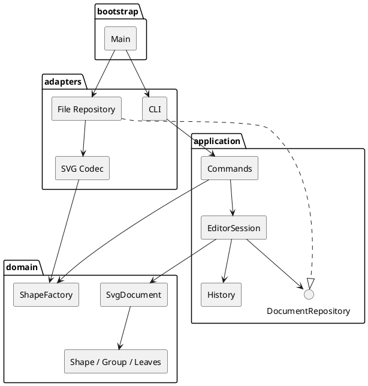

# 架构方案

## 模块与依赖

| 模块            | 责任                                         | 允许依赖                              |
| --------------- | -------------------------------------------- | ------------------------------------- |
| src/domain      | 有行为的 Shape 类、Composite、文档树与不变量 | 本模块；不得依赖 Node/终端/文件/XML库 |
| src/application | Command、快照历史、会话、持久化端口          | domain、本模块                        |
| src/adapters    | CLI 解析展示、XML 编解码、原子文件 IO        | domain、application、第三方/Node      |
| src/bootstrap   | 实例装配与启动                               | 所有层                                |

测试和实验脚本可以访问各层。架构测试自动检查导入方向、一类一文件和 switch 分派；代码自查复核名称判断没有绕过两处注册表。

图源 [architecture.puml](architecture.puml)，已实际渲染。

## 模式与接口

- Composite：Shape 的 move/scale/set/clone；Group 管理子节点递归处理，叶子封装几何属性。
- Command：各命令独立类，编辑命令基类持有前后快照，实现 execute/undo/redo；History 仅处理编辑命令。
- Memento：对草稿执行、检查、提交，读写显示不暴露历史引用。领域复制依靠多态 clone，不用 JSON 数据袋代替类。
- Factory：命令注册表与 ShapeFactory 为仅有的两处名称分派。图形工厂复用于 CLI/XML。按附件要求，这两处登记为后续插件注册重构点（TECH-01），首版保持固定注册。
- DocumentRepository：应用层声明读写端口；文件适配器处理编码、临时文件与重命名。
- Shape 通过只读属性描述支持通用展示和 SVG 输出，不再 switch(tag)。

## 数据流与不变量

输入 → Tokenizer → 命令表 → 命令校验 → 会话草稿 → 领域操作 → 树校验 → 提交/入历史 → 输出。

导入 → XML 校验 → 完整扫描显式 id → 样式/变换规范化 → 共用图形工厂 → 完整文档校验 → 替换会话。所有警告在成功后输出。

不变量：唯一 id、父子一致、无环、索引与文档树一致、有限数值、非负尺寸、非共享快照。

## 变化点与取舍

| 变化点        | 首版准备与取舍                                                 |
| ------------- | -------------------------------------------------------------- |
| 新交互入口    | 业务命令与终端隔离，可增加 GUI/agent adapter                   |
| 新图形/插件   | 集中图形工厂；不提前实现动态加载与 box                         |
| 文件格式/存储 | Repository 接口隔离；SVG codec 独立                            |
| 更大文档      | 首版快照确保原子性，测量 100/1000/10000 元素；后续可换增量历史 |
| 更多 SVG 特性 | 严格兼容边界与失败原子性；不静默丢弃不支持绘制特性             |

## 评审方式

当前为单人项目，由 Codex 执行实现与自查，自动测试提供独立于操作结果的断言。没有外部人员审批或独立人工评审，不将自查描述为第三方评审。

## 最终一致性检查

实际目录与上述四层一致。AST 检查逐文件导入和类名/文件名，核心无 IO/第三方依赖；源码复核没有其他 shape/command 名称分派。应用端口由适配层实现，DTO 只用于边界，不替代领域对象。课程提交文档包含完整汇总。

## 发布后浏览器预览架构（ADR-006）

以上已渲染组件图对应 final 课程基线。扩展仍遵守四层依赖：Main → PreviewServer → EditorSession / SvgCodec / PreviewPage。PreviewServer 和 PreviewPage 位于 adapters/preview；没有领域层修改，没有命令工厂之外的命令分派。

EditorSession 的只读 revision 在成功 init/read/resize/edit/undo/redo 后递增，查询、save、失败命令不递增。HTTP 适配器按版本缓存 SVG，首次请求读取 document 副本并编码；相同版本的条件请求返回 304。浏览器每次请求完成后 300ms 再请求，4 秒超时，不堆叠并发请求。渲染异常只影响 HTTP 请求，不改变命令结果或文档历史。Main 在 REPL 结束的 finally 中关闭服务器和连接。

边界：127.0.0.1 动态端口、随机会话路径、Host/Origin/Fetch Metadata 检查、只读 GET，无文件路径映射。带会话路径的顶层页面导航可从外部链接进入；state 数据仍拒绝跨站访问。图片方式隔离 SVG，CSP 禁止额外脚本/资源和 iframe 嵌入。详情和实际验收见 [REQ-15 扩展报告](extensions/live-preview.md)。
